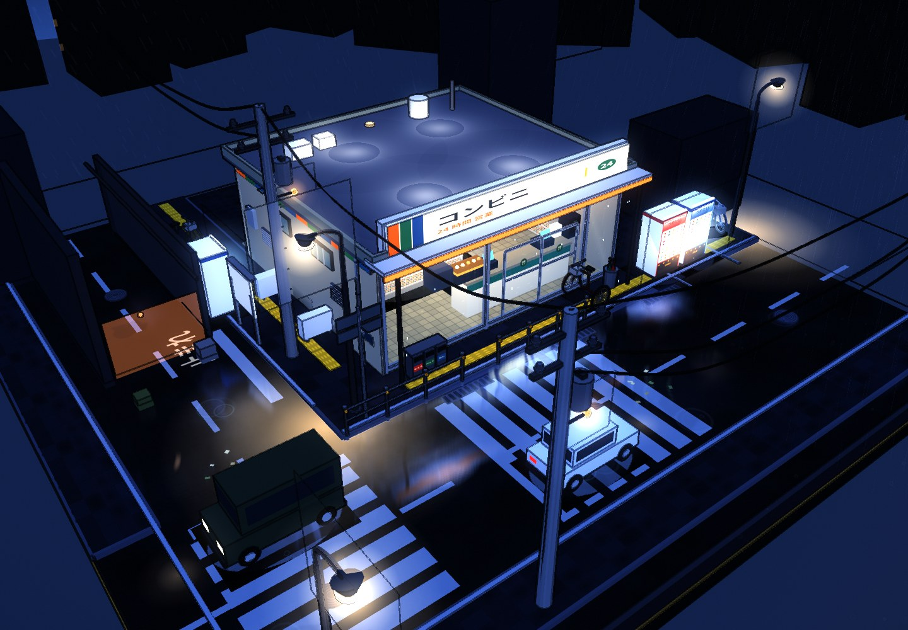
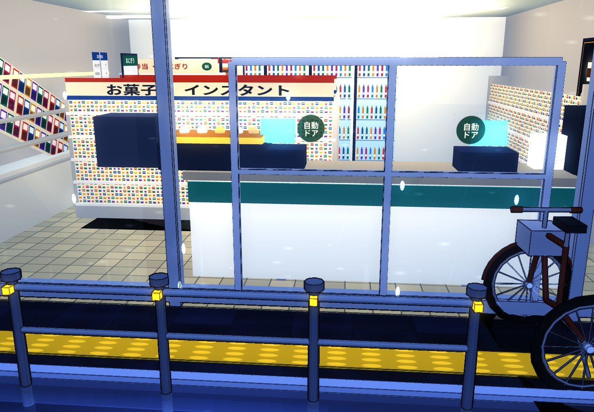
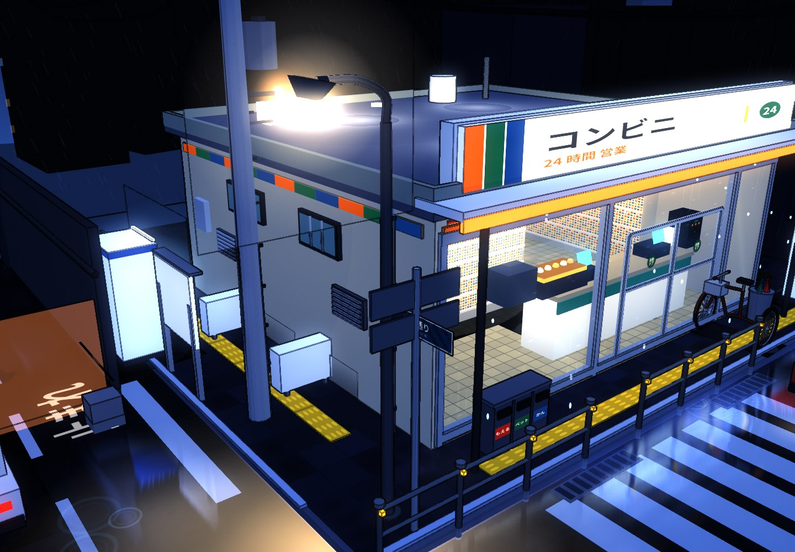

# 雨夜コンビニ · Rainy Night Konbini

**A rainy-night Japanese convenience-store street corner, as a tiny collectible diorama — built entirely in HTML + Three.js.**

No characters. No UI. Just a square miniature world you can drag, spin and zoom into, like a single frame lifted out of an anime and frozen in place.

### ▶ [**打开在线演示 / Live Demo**](https://emocow-liuyun.github.io/rainy-night-konbini/)

<p align="center">
  <a href="https://emocow-liuyun.github.io/rainy-night-konbini/">
    
  </a>
</p>

<p align="center">
  
  
</p>

---

## What it is

A 20 × 20 square miniature base. In the middle sits a Japanese convenience store, warm and bright and thoroughly stocked, seen clearly through a large glass facade. Around it: a real street corner, with a main road, a side street, crosswalks, traffic lights, vending machines, utility poles and sagging power lines, a guarded corner, an alley mouth leaking warm light from somewhere deeper in.

Outside is cold blue, wet and quiet. Inside is warm white, cluttered and lived-in. That contrast is the whole emotional point of the piece.

Rain keeps falling, water slides down the glass, and wet asphalt holds vertical streaks of every lamp. Occasional sedans, kei cars, vans and taxis pass the corner, with quiet gaps between trips. No pedestrian models, walking logic or navigation modules are loaded.

---

## Running it locally

```bash
git clone https://github.com/emocow-liuyun/rainy-night-konbini.git
cd rainy-night-konbini
python3 serve.py
```

Opens `http://127.0.0.1:8080` automatically. Any static server works:

```bash
python3 -m http.server 8080
```

> Must be served over HTTP — ES Modules are blocked by the browser's CORS policy when opened straight from disk. All imports use explicit relative paths (no import map, no bundler), so any static server works.

### Controls

| Input | Action |
|---|---|
| Left drag | Orbit |
| Wheel / pinch | Zoom (10 – 70 units) |
| Right drag | Pan |
| Idle | Slow automatic orbit (stops the moment you touch it) |

---

## Inside the store

Visible through the glass, front to back:

- **Rear wall** — five-door drink refrigerator bank with self-lit shelves, staff door, lockers
- **Aisles** — two five-tier gondolas, product faces turned toward the window, end-cap POP signs and overhead ad strips
- **Chilled** — bento and onigiri display case with a price-tag lightbox
- **Counter** — twin registers with customer-facing displays, an oden hot case (glass hood, broth, skewers), a coffee machine, a hot-snack warmer
- **Back counter** — four-tier tobacco/liquor shelving with a lightbox header
- **Reading** — angled magazine rack, oden menu board, store directory sign, three posters
- **Floor** — product stacks, a POP standee, direction arrows
- **Lighting** — eight ceiling panels plus multiple warm point lights

Outside: illuminated sign box, tri-color identity band, rain canopy with warm light strip, entrance mat, umbrella stand, three-way sorting bins, AC condensers, meter box, rear door with step, rooftop equipment (condenser, vent stack, water tank, skylight lamps), side-wall clerestory windows, louvres, downpipe and wall staining.

## The street

Crosswalk, stop line, painted `止まれ`, centre dashes, tactile paving, kerbs, gutters, manhole covers, parking bays. Three street lamps, three utility poles with sagging lines, a corner street sign, two guardrails, a notice board, an alley mouth, a traffic light cycling through red/amber/green with a pedestrian signal, three bicycles and three vending machines.

In the distance: a rainy night sky dome with fbm cloud layers and city glow, 44 building silhouettes with randomised window lights, and a horizon haze band.

---

## How it's drawn

### Cel shading

Every solid surface uses `MeshToonMaterial` with a 5-step `DataTexture` gradient — light quantises into hard bands, giving flat anime cel colour.

Outlines are not Freestyle. They come from a custom post chain:

1. Render a separate **normal + view-depth** buffer (normals in RGB, depth in alpha)
2. In the composite pass, run a Sobel difference on it: normal gradient *and* depth Laplacian, summed
3. Ink with a very dark cool colour (`#090d15`) rather than pure black, so it reads as ink instead of plastic

Bloom: soft threshold on luminance → two-pass separable Gaussian (twice, second pass at larger stride) → add. Only genuine emitters halo; white walls stay crisp.

Finally a dual tonal split — cool in the shadows, warm in the highlights — plus faint grain and a vignette.

### Wet ground

The part that took the most iterations.

1. **Planar reflection** — mirrored camera with an oblique clip plane culls everything below the ground, rendered to a half-resolution target
2. **Wetness mask** — a 1024² top-down map composited from fbm noise, elliptical gradients per puddle, linear gutter pooling, and the rain-shedding zone under the canopy; world coordinates map straight to UV
3. **Fresnel weighting** — reflection strength follows grazing angle, weak from above, strong near the ground plane
4. **Vertical stretch** — 11 taps along screen-space Y, smearing every lamp into a vertical streak on the wet asphalt

Step 4 is what actually sells "rainy night". Without it the ground is merely *a bit brighter*; with it you get the long vertical light trails that anime streetside shots always have.

The reflective surface is layered at three ground heights (asphalt `0.014`, lot paving `0.104`, sidewalk `0.154`) — otherwise the upper paving simply covers it.

---

## Motion

| Effect | Implementation |
|---|---|
| Continuous rain | 5,200 GPU-instanced streaks, displacement looped in the vertex shader, slanted by wind |
| Rain splashes | Shader-driven ring bursts, randomised period and position |
| Eave drips | Instanced droplets, gravitational acceleration, stretched along Y |
| Puddle ripples | Ring texture expanding with a quadratic fade |
| Sign | Steady lightbox emission and bloom |
| Automatic door | Random intervals, eased translation of both glass leaves |
| Glass runoff | Scrolling UVs over a procedural droplet texture |
| Ground reflection | Mirrored render every frame, time-perturbed |
| Traffic light | Red / amber / green cycle with matching pedestrian signal |
| Interior lights | Faint intensity breathing on the point lights |
| Clouds / haze | Time-driven fbm noise |

---

## Structure

```
rainy-night-konbini/
├── index.html              entry point (native ESM)
├── serve.py                local preview server
├── vendor/
│   ├── three.module.js          three.js r170
│   ├── OrbitControls.js
│   └── BufferGeometryUtils.js   geometry merging
└── src/
    ├── core.js             palette / toon materials / geometry cache / canvas textures
    ├── base.js             diorama base / roads / sidewalks / markings / puddles
    ├── store.js            store building + full interior fit-out
    ├── props.js            vending machines / bicycles / lamps / poles / signs / guardrails / alley / traffic light
    ├── effects.js          rain / splashes / drips / ripples / glass runoff / flicker / backdrop rain
    ├── atmos.js            night sky dome / city silhouettes / horizon haze
    ├── batch.js            static geometry merging (draw-call reduction)
    └── main.js             renderer / planar reflection / post-processing / animation loop
```

---

## Debug parameters

Camera override via query string:

```
?cx=-11&cy=12.6&cz=15.6&tx=0.7&ty=-0.5&tz=0.2&fov=41
```

`cx, cy, cz` camera position · `tx, ty, tz` look target · `fov` field of view.

- `?refl=1` — output the reflection buffer directly
- `?hide=lamp,gondola` — hide subtrees by object name
- `?debug=1` — expose `window.__KONBINI` for profiling (draw calls, object counts)

---

## Performance

The scene batches static geometry and reuses materials. Cars are merged per vehicle; no pedestrian simulation is loaded. Reflection and outline buffers refresh every frame. Adaptive resolution lowers the pixel ratio on sustained slow frames.

Historical profiling numbers are omitted because they describe earlier versions, not this configuration.

### Tunables

- `REFL_SCALE` in `main.js` — reflection resolution, default `0.4`; raise to `0.75` or `1.0`
- `NORMAL_INTERVAL` / `REFL_INTERVAL` — pass refresh intervals
- `buildRain({ count })` — rain streak count, default 5,200

Adaptive resolution steps `pixelRatio` down to a floor of 1.0 on sustained slow frames.

Measured at a stable 60 fps on an RTX 5070 at 1600 × 1000, p95 frame interval 16.7 ms.

## Technical notes

- [three.js](https://threejs.org/) r170, vendored locally — no build step, no CDN dependency
- Native ES Modules
- Every texture is generated procedurally with Canvas 2D; no external image assets
- Every mesh is built in code; no external model files

## License

[MIT](LICENSE)
